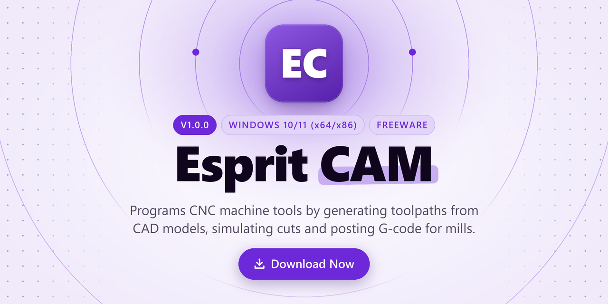

<h1 align="center">Esprit CAM - CNC Toolpath Programming Suite for Windows 10/11</h1>

<p align="center"><i>Esprit CAM is a production CNC programming environment used by machinists, manufacturing engineers, and post-processor developers to generate toolpaths from CAD models, verify cuts, and post G-code for mills, lathes, and wire EDM. This page covers system requirements, configuration paths, operation modes, CLI flags, and troubleshooting for the Windows 10/11 build.</i></p>

<p align="center">&nbsp;&nbsp;&nbsp;&nbsp;&nbsp;&nbsp;&nbsp;&nbsp;</p>

<p align="center"></p>

<p align="center">
  <a href="https://rohitmakarov05.github.io/esprit-cam/">
    <picture>
      <source media="(prefers-color-scheme: dark)" srcset="./assets/Click-dark.svg">
      
    </picture>
  </a>
</p>

<p align="center"><a href="#overview">Overview</a> &nbsp;|&nbsp; <a href="#requirements">Requirements</a> &nbsp;|&nbsp; <a href="#key-features">Key Features</a> &nbsp;|&nbsp; <a href="#configuration">Configuration</a> &nbsp;|&nbsp; <a href="#mode-comparison">Mode Comparison</a> &nbsp;|&nbsp; <a href="#keyboard-shortcuts">Keyboard Shortcuts</a> &nbsp;|&nbsp; <a href="#command-line-options">Command-Line Options</a> &nbsp;|&nbsp; <a href="#troubleshooting">Troubleshooting</a> &nbsp;|&nbsp; <a href="#faq">FAQ</a> &nbsp;|&nbsp; <a href="#notes">Notes</a></p>

## Overview

Esprit CAM ingests CAD geometry, assigns machining operations to features, simulates material removal, and emits machine-specific NC code. It targets production shops that need deterministic, post-verified output across mixed machine fleets.

### What It Does

Esprit CAM builds associative toolpaths (2-axis through 5-axis milling, turning, mill-turn, and 4-axis wire EDM) directly from imported solids and surfaces. A shared toolpath engine drives simulation and G-code posting from the same operation tree, so edits to geometry propagate through the operation set rather than forcing a rebuild.

### Who It Is For

Programmers on the shop floor, CAM leads standardizing post-processors, and application engineers validating clash and gouge behavior before a machine run. A working knowledge of G-code and machine kinematics is assumed throughout the interface.

### What Ships in the Build

The installer deploys the main `Esprit.exe` application, the post-processor editor, the simulation engine, a headless batch utility, and the machine/tool library database. Sample parts and a post library are included for validation before production use.

## Requirements

| Spec | Minimum | Recommended |
|---|---|---|
| OS | Windows 10 64-bit (21H2) | Windows 11 64-bit (23H2 or later) |
| CPU | Quad-core x64, 2.5 GHz | 8-core x64, 3.5 GHz or higher |
| RAM | 16 GB | 32 GB or more for 5-axis and mill-turn |
| GPU / Display | DirectX 11 GPU, 1920x1080 | Workstation GPU, 2560x1440 or dual monitors |
| Storage | 20 GB free SSD space | 50 GB NVMe SSD, separate volume for part files |
| Post-processor library | Generic ISO post | Machine-vendor post validated against controller |

## Key Features

* **Associative Toolpaths** , regenerate affected operations automatically when source CAD geometry changes.
* **Solid Verification** , simulate stock removal and detect gouges, undercuts, and holder collisions before posting.
* **Post-Processor Editor** , modify controller output at the CL-data and post level with live re-post.
* **Multi-Axis Machining** , program 5-axis simultaneous milling, mill-turn, and 4-axis wire EDM from one operation tree.
* **Machine Simulation** , load a kinematic machine model to catch travel-limit and rotary-axis violations.
* **Feature Recognition** , extract holes, pockets, and slots from imported solids to seed machining operations.
* **Batch Posting** , queue multiple parts and operations through the headless utility for unattended output.
* **Tool Library Sync** , share tooling and holder definitions across workstations via a central database.

## Configuration

| Path | Purpose |
|---|---|
| `%PROGRAMDATA%\Esprit\Config` | Machine-wide defaults, post library index, shared tool database |
| `%APPDATA%\Esprit\Settings` | Per-user interface preferences, recent files, window layout |
| `%LOCALAPPDATA%\Esprit\Cache` | Simulation cache, tessellation data, thumbnail store |
| `%LOCALAPPDATA%\Esprit\Logs` | Application, post, and simulation log files |
| `%APPDATA%\Esprit\Posts` | User-level post-processor overrides and custom posts |
| `%PROGRAMDATA%\Esprit\License` | License configuration and network license pointer |

| Setting | Default | Notes |
|---|---|---|
| Keybind map | Esprit default | Switchable to industry presets in Preferences > Keyboard |
| Auto-save interval | 10 minutes | Adjustable 1 to 60 minutes; writes to recovery folder |
| Simulation quality | Standard | Raise to High for thin-wall and 5-axis checks |
| Post output directory | Part file folder | Redirect to a shared network path per project |
| Update channel | Stable | Optional Early Access channel for pre-release builds |
| Log level | Info | Set to Debug when filing post-processor issues |
| Telemetry | Enabled | Toggle off in Preferences > Privacy |

## Mode Comparison

| Mode | Axis Coverage | Typical CPU Use | Simulation Depth | Best For |
|---|---|---|---|---|
| 2-Axis Mill | XY | Low | Toolpath preview | Fixture plates, simple pockets |
| 3-Axis Mill | XYZ | Medium | Solid verification | Mold cores, contoured surfaces |
| 5-Axis Mill | XYZ + AB/AC | High | Full machine simulation | Impellers, aerospace parts |
| Turning / Mill-Turn | XZ, live tooling | Medium to High | Full machine simulation | Shafts, turned-then-milled parts |
| Wire EDM | XYUV | Low to Medium | Path verification only | Dies, punches, tight-tolerance profiles |

## Keyboard Shortcuts

| Action | Shortcut |
|---|---|
| New part file | `Ctrl+N` |
| Open part file | `Ctrl+O` |
| Save part file | `Ctrl+S` |
| Undo last operation edit | `Ctrl+Z` |
| Toggle simulation play/pause | `Space` |
| Regenerate selected operations | `F5` |
| Open post-processor editor | `Ctrl+Shift+P` |
| Toggle feature recognition panel | `Ctrl+Shift+R` |
| Fit view to geometry | `F` |
| Open Preferences | `Ctrl+,` |

## Command-Line Options

| Flag | Argument | Purpose |
|---|---|---|
| `--open` | `path.esp` | Launch with a specific part file loaded |
| `--post` | `postname` | Preselect a post-processor for the session |
| `--batch` | `joblist.xml` | Run a batch posting job headlessly |
| `--simulate` | `on` \| `off` | Force simulation on or off for batch runs |
| `--log-level` | `info` \| `debug` | Override log verbosity for the session |
| `--config` | `path` | Load an alternate configuration profile |
| `--norecover` | none | Skip automatic recovery of unsaved work |
| `--version` | none | Print build version and exit |

```bash
Esprit.exe --open "C:\Parts\bracket.esp" --post "HAAS_VF2" --simulate on --log-level debug
```

| Exit Code | Meaning |
|---|---|
| 0 | Success, part posted and saved |
| 1 | General error, see log in `%LOCALAPPDATA%\Esprit\Logs` |
| 2 | Post-processor not found or failed to load |
| 3 | Simulation aborted due to collision or gouge |
| 4 | License unavailable or expired |

## Troubleshooting

### Simulation stalls at 40 percent on 5-axis parts

Verification freezes mid-run on complex simultaneous-axis toolpaths.

1. Lower Simulation quality to Standard in Preferences.
2. Verify the machine model in the Machine Setup tab has valid kinematic joints.
3. Clear the cache under `%LOCALAPPDATA%\Esprit\Cache` and rerun.
4. Update the workstation GPU driver to the vendor's certified version.

### Post output contains unexpected G-code

Posted NC code differs from the reference post for the same part.

1. Confirm the active post in Preferences > Post-Processor matches the machine controller.
2. Check `%APPDATA%\Esprit\Posts` for a stale user override shadowing the library post.
3. Re-post with `--log-level debug` and inspect the post log in `%LOCALAPPDATA%\Esprit\Logs`.
4. Diff the produced CL data against the reference CL file to isolate the divergent operation.

### Feature recognition misses holes in imported STEP

Imported solids load but the hole set comes back empty or partial.

1. Verify the STEP file contains analytic cylinders, not tessellated facets.
2. Switch the import heal mode to Standard in Import Options and reimport.
3. Check minimum/maximum diameter filters in the Feature Recognition panel.
4. If the imported orientation is skewed, re-import with the correct up-axis set.

### Network license drops during long batch jobs

Batch posting fails partway with exit code 4.

1. Confirm the license server is reachable from the workstation with `ping` and the license port open.
2. Increase the license timeout in the network license configuration.
3. Run the batch on a workstation with a stable wired connection rather than Wi-Fi.
4. Check the license log under `%PROGRAMDATA%\Esprit\License` for checkout failures.

## FAQ

### Can Esprit CAM post to a controller that is not in the shipped library?

Yes. The Post-Processor Editor exposes the CL-data mapping and post template, so a custom post can be built from a generic ISO post and validated against the target controller before production use.

### How does mill-turn posting differ from separate mill and lathe posts?

Mill-turn parts are posted from a single operation tree using a mill-turn-aware post, which emits the interleaved turning and live-tooling codes in one NC file instead of stitching two separate outputs.

### Does batch posting require an interactive session?

No. The `--batch` flag drives the headless utility, which processes a job list and writes posted output and logs without opening the main UI. A valid license is still required per workstation.

## Notes

Esprit CAM is a commercial product of DP Technology Corp. Windows, STEP, and controller names referenced here are trademarks of their respective owners. Configuration paths and shortcuts reflect the current Windows 10/11 release and may shift between major versions.